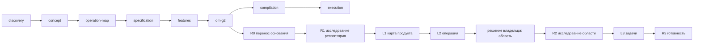

# Смысловая схема прохождения простого проекта по OMG

Страница 1 из 2. Черновик Fable, 09.09.2026 01:30. Без прогонов и токенов.

Что здесь факт из кода OMG, помечено «(код)». Всё остальное про пример — смысловое предложение, его и обсуждаем.

## Проект-пример: «notes»

Три файла: `notes.py` (команды `add`, `list`, `search`), `store.py` (SQLite `notes.db`), `README.md`. Один пользователь, один процесс, никаких внешних сервисов.

Запрос владельца: «Хочу, чтобы каждая заметка автоматически появлялась как markdown-файл рядом с базой. Если файлы пропали или побились, они восстанавливаются из базы одной командой, без ручной работы».

Почему именно это: по форме это та же потребность, что настоящая задача OMG про файловые проекции стадий рядом с SQLite. Схема, построенная на игрушке, переносится на реальный случай один в один.

## Поток стадий (код: `src/pipeline/contracts.ts`, STAGES)

## Одна строка на стадию: вход, кто отвечает, выход, потребитель

| Стадия | Вход | Код без модели | Вопрос модели и ответ для «notes» | Выход | Потребитель выхода | Владелец |
|---|---|---|---|---|---|---|
| discovery | запрос владельца + репозиторий | сохранить запрос как источник; просканировать файлы, размеры, языки | «Что это за продукт, кто им пользуется, какой ближайший полезный результат?» → CLI для одного пользователя; ближайший результат: markdown-проекции рядом с базой | описание продукта, ближайший результат | concept | подтверждает ближайший результат |
| concept | discovery | связать требования с запросом | «Какие требования и границы? Что входит в малый горизонт?» → req-projections, req-recovery, req-no-manual-edits (ручная правка файла не меняет базу) | список требований с пользой и потребителем | operation-map, specification | принимает требования |
| operation-map (L1) | concept + факты о репозитории | построить граф из узлов и связей, проверить связность | «Какие узлы у продукта и как связаны?» → n-cli, n-store, n-project, n-recover, n-search; связи: cli→store, store→project, recover→store→project | карта из 5 узлов | specification, om-g2 | смотрит карту целиком |
| specification | карта + требования | привязать поведение к узлам | «Какое наблюдаемое поведение обязательно?» → после add/edit файл есть не позже 1 с; удаление файла руками не меняет базу; `notes recover` восстанавливает все файлы из базы | список поведений с проверкой каждого | features, тесты | принимает поведения |
| features | specification | разбить на атомарные фичи, проверить, что каждое поведение покрыто | «Какие фичи и в каком порядке?» → f-projections (публикация после записи), f-recover (команда восстановления) | фичи с порядком и покрытием | om-g2 | выбирает горизонт |
| om-g2 / R0 | принятые стадии | перенести основания в исследование (код) | вопросов модели нет | основания R0 | R1 | нет |
| om-g2 / R1 | репозиторий | подать файлы страницами, хранить цитаты | 9 полей (код: `research-contracts.ts`, TECHNICAL_RESEARCH.R1). Для notes по смыслу нужны 4: productDomain, persistence, recovery, evidenceAndTests. Остальные 5 «неприменимо» одной строкой: нет полномочий, интеграций, воркеров, поставки, входов кроме CLI | факты с цитатами `store.py:NN` + пробелы | L1, L2, R2 | нет |
| om-g2 / L1, L2 | R1 + карта | собрать слои, проверить связи с картой | «Какие операции нужны для требований?» → o-project (публикация файла после COMMIT), o-recover (восстановление из базы) | операции с входами и выходами | решение владельца, R2 | выбирает область: o-project |
| om-g2 / R2 | область + L2 + R1 | сформировать вопросы из 4 типов × область + пробелы (код: TECHNICAL_RESEARCH.R2, refinementQuestions) | contractsAndConsumers: кто пишет в базу (`store.save`), кто читает файлы (пользователь, редактор). stateAndRecovery: файл пишется только после COMMIT; сбой между ними лечит recover. connectivityAndProof: тест add→файл; удалить файл→recover вернул. authorityPaths: неприменимо, один пользователь | ответы с цитатами, обязательства | L3 | нет |
| om-g2 / L3 | ответы R2 + операции | собрать задачи с обязательствами | «Какие атомарные задачи?» → 1) вызов публикации после commit в `store.py`; 2) модуль `project.py`; 3) команда `recover`; 4) тесты трёх поведений | задачи с проверками | R3, compilation | нет |
| om-g2 / R3 | задачи | проверить среду (python, sqlite) и обязательства | вопросов модели нет | готовность | compilation | нет |
| compilation | задачи | построить машинный план: порядок, зависимости, проверки | «В каком порядке и с какими проверками?» | план | execution | подпись плана |
| execution | план | запуск задач, тесты, коммиты, независимое ревью | исполнитель пишет код задачи; ревьюер проверяет | изменения в репозитории, зелёные тесты | владелец | приёмка результата |

## Кто и сколько раз спрашивает модель на всём пути для «notes»

По смыслу: discovery 1, concept 1, карта 1, specification 1, features 1, R1 4 вопроса по 1–2 страницы, L1/L2 1, R2 3 вопроса (один «неприменимо» без вызова), L3 1, compilation 1, execution по числу задач (4) плюс ревью (4). Итого около 25 вызовов на весь путь. Где модель не нужна: R0, R3, сканирование репозитория, сборка графа, проверка связности, цитаты, бюджет, файлы.

## Что сейчас в OMG сверх этого, по фактам сегодняшнего дня

Каждый пункт: что это, зачем появилось, нужно ли для «notes».

| Механизм в OMG | Зачем появился | Нужен ли для «notes» |
|---|---|---|
| Страницы материалов, продолжения, упаковка пакета (continuation-packet, working-context) | репозиторий OMG не влезает в один запрос | нет: три файла влезают целиком в один запрос |
| Сводки заметок, сжатие, ужатие (conclusion-consolidation) | заметки по 7 страницам не влезали в лимит 100 000, который сами и поставили | нет |
| Контекст-чтения read_context, счётчики, финализация (context-workspace, synthesis-controls) | модель просила один и тот же контекст повторно | нет, если весь код в пакете |
| Восстановление ответа модели (response-recovery), нормализация формы ответа | ответы модели отвергались по форме | форма ответа задаётся один раз в инструкции |
| Обязательства, проверки среды, отпечаток адаптера (obligation-policy, runtime checks, adapter-lineage) | R3 требует доказательств среды; оценщик бюджета сломался после перезагрузки | для notes: одна проверка «python и sqlite есть» |
| Участки бюджета с потолками (research-trial, phase-policy) | защита от перерасхода | один потолок на проект |
| Ремонты 5а–5л за сутки | каждая пауза была дефектом движка на живых данных | показывают, где движок сложнее задачи |

## Что решить по этой схеме

1. Стадии: все восемь нужны, или для малого проекта concept и specification сливаются в одну?
2. R1: 9 полей всегда, или модель сама помечает «неприменимо» без отдельного вызова?
3. Где граница «весь код в одном запросе»: до какого размера репозитория страницы и сжатие вообще не включаются?
4. Что считать доказательством на каждом шаге: цитата `файл:строки` и ничего больше?
5. Какие места владельца обязательны: ближайший результат, область, подпись плана, приёмка. Остальное автоматом?

Страница 2 (после твоих ответов): та же схема с инструментами на каждый этап и сверка с тем, что реально есть в коде OMG, файл за файлом.
