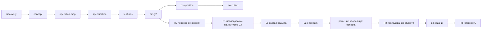

# Смысловая схема прохождения проекта sealvoy-protocol (внутреннее имя asvp) по стадиям OMG

Страница 1 из 2. Черновик Fable, 09.09.2026 02:15. Без прогонов и токенов.

Пометки: «(код)» — факт из кода OMG; «(файл V3)» — из TASKPLAN PRO V3/PREPARATION/POST-OMG2-IMPROVEMENTS.md, разделы H-PROTO от 31.08 и 01.09; всё остальное — смысловое предложение, его и обсуждаем. Имя Sealvoy выбрано владельцем 09.09 02:10; полное имя Agent SealVoy Protocol, внутреннее имя asvp; следующий продукт Sealvoy Harness, внутреннее имя asvh; H-proto остаётся историческим кодовым именем в документах V3.

## Проект

**Sealvoy** — протокол аттестованного межагентного обмена: организации обмениваются запечатанными пакетами результатов работы ИИ-агентов, а получатель проверяет происхождение пакета и его соответствие согласованному договору-схеме (файл V3). Позиция — слой доверия поверх любого транспорта; пакет самодостаточен и едет хоть по почте, хоть на флешке (файл V3).

**Форма строительства по решению 01.09 (файл V3):** спецификация с нуля, транспортно-нейтральная; механика не переписывается — примитивы V3 (канон ByteManifest, впуск, печати, атомарный писатель, реестры с подписями и сроками, стражи маскарада и окон, sealed toolchain) выносятся в переиспользуемые пакеты, Sealvoy берёт их как зависимости; первые аттестованные пакеты — свидетельства прогонов самого V3.

**Запрос владельца для схемы (первый ломоть, предложение Fable):** «Формат самодостаточного запечатанного пакета результата и проверка впуска по договору-схеме для одной пары сторон: отправитель и получатель, один договор-схема, один подписант. Криптоподписи юрлиц, шлюз, реестр договоров и арбитраж-повтор — следующие ломти».

**Потребители:** организация-отправитель (оператор агента), организация-получатель (впуск), позже арбитр и аудитор.

## Поток стадий (код: `src/pipeline/contracts.ts`, STAGES)

## Особенность этого проекта: репозитория ещё нет

OMG на стадии R1 исследует существующий репозиторий (код: TECHNICAL_RESEARCH.R1, 9 полей). У Sealvoy своего кода нет. Два честных варианта, решение за владельцем:

- **Вариант А.** «Репозиторием» для R1 считать только пять примитивов V3, которые Sealvoy берёт как зависимости: ByteManifest, впуск, печати, атомарный писатель, реестры. Исследуется ограниченный набор файлов, остальной V3 не трогается.
- **Вариант Б.** R1 пропускается как «неприменимо», основания берутся из документов V3 и спецификации. Тогда L1 и L2 строятся из концепции, а не из кода.

Схема ниже написана под вариант А.

## Одна строка на стадию

| Стадия | Вход | Код без модели | Вопрос модели и ответ для Sealvoy | Выход | Потребитель | Владелец |
|---|---|---|---|---|---|---|
| discovery | запрос владельца; разделы H-PROTO из файла V3; пять примитивов V3 | сохранить запрос и документы как источники; просканировать файлы примитивов | «Что за продукт, кто им пользуется, какой ближайший полезный результат?» → протокол обмена запечатанными пакетами между двумя организациями; ближайший результат: пакет v1 + впуск по одной договор-схеме; самодоказательство — пакет из свидетельств прогона V3 | описание продукта, ближайший результат | concept | подтверждает ближайший результат |
| concept | discovery | связать требования с запросом и документами | «Какие требования и границы? Что входит в малый горизонт?» → req-self-contained-package (результат, хэши входа, кода и модели, журнал, подпись); req-contract-admission (договор-схема как исполняемая проверка у обеих сторон); req-two-claim-classes (самодоказуемое против заявленного); req-transport-neutral; req-local-first; req-counter-receipt (встречная квитанция) | требования с пользой и потребителем | operation-map, specification | принимает требования |
| operation-map (L1) | concept + факты о примитивах | построить граф узлов и связей, проверить связность | «Какие узлы и как связаны?» → n-package (формат), n-seal (хэши и подпись), n-contract (договор-схема), n-admission (проверка впуска), n-journal (журнал исполнения), n-receipt (встречная квитанция), n-claims (словарь утверждений), n-transport (любой, вне протокола) | карта из 7–8 узлов | specification, om-g2 | смотрит карту целиком |
| specification | карта + требования | привязать поведение к узлам, каждому поведению — проверка | «Какое наблюдаемое поведение обязательно?» → П1: полный пакет проходит проверку; П2: изменённый байт — отказ с типизированной причиной; П3: пакет не по договор-схеме — отказ до чтения содержимого; П4: самодоказуемые утверждения проверяются математикой, заявленные сохраняются как заявления под подписью; П5: квитанция получателя — сама запечатанный пакет; П6: всё работает из файла без сети | поведения с проверками | features, тесты | принимает поведения |
| features | specification | разбить на фичи, проверить покрытие поведений | «Какие фичи и порядок?» → f-package-format, f-seal-verify, f-contract-schema, f-admission-cli, f-counter-receipt, f-self-proof (пакет из прогона V3) | фичи с порядком | om-g2 | выбирает горизонт: первые три плюс CLI |
| om-g2 / R0 | принятые стадии | перенос оснований (код) | без модели | основания | R1 | нет |
| om-g2 / R1 | пять примитивов V3 | подать файлы, хранить цитаты `файл:строки` | 9 полей (код). По смыслу применимы 6: productDomain (сущности пакета и печати), persistence (реестр схем, журнал, sole writer), authority (подписи, цепочка делегирования, доверенные входы — здесь это суть продукта), integrations (границы файловой системы и процессов, версии контрактов), recovery (повтор, идемпотентность впуска), evidenceAndTests (реальные entrypoints и негативные проверки примитивов). Неприменимы одной строкой: actorsAndChannels (только CLI), runtime (один процесс), delivery (версия спецификации, без развёртывания) | факты с цитатами + пробелы | L1, L2, R2 | нет |
| om-g2 / L1, L2 | R1 + карта | собрать слои, сверить с картой | «Какие операции нужны?» → o-seal (собрать и запечатать пакет), o-admit (проверить по договор-схеме), o-receipt (выдать квитанцию), o-register-schema (зарегистрировать договор-схему локально) | операции с входами и выходами | решение владельца, R2 | выбирает область: o-seal + o-admit |
| om-g2 / R2 | область + L2 + R1 | сформировать вопросы: 4 типа × область + пробелы (код: TECHNICAL_RESEARCH.R2, refinementQuestions) | contractsAndConsumers: производитель — печать отправителя, потребитель — впуск получателя; схемы: package v1, contract-schema v1. authorityPaths: кто подписывает, цепочка делегирования, подмены: чужой ключ, повтор старого пакета, подмена договор-схемы. stateAndRecovery: журнал только на дозапись, повторный впуск идемпотентен, неполный пакет. connectivityAndProof: исходы missing / extra / foreign / stale / forged / replay — совпадают один в один с формулировкой вопроса в коде | ответы с цитатами, обязательства | L3 | нет |
| om-g2 / L3 | ответы R2 + операции | собрать задачи с обязательствами | «Какие атомарные задачи?» → 1) схема пакета v1; 2) хэширование и печать; 3) проверка впуска по договор-схеме; 4) CLI seal / admit; 5) негативные тесты на шесть исходов; 6) самодоказательство: пакет из прогона V3 | задачи с проверками | R3, compilation | нет |
| om-g2 / R3 | задачи | проверить среду: рантайм, криптобиблиотека, тестовые ключи (код: runtime checks) | без модели | готовность | compilation | нет |
| compilation | задачи | план: порядок, зависимости, проверки | «В каком порядке и с какими проверками?» | план | execution | подпись плана |
| execution | план | запуск задач, тесты, коммиты, независимое ревью | исполнитель пишет код задачи; ревьюер проверяет | код и зелёные тесты | владелец | приёмка |

## Сколько раз модель нужна на всём пути

По смыслу: discovery 1, concept 1, карта 1, specification 1, features 1, R1 6 вопросов, L1/L2 1, R2 4, L3 1, compilation 1, execution 6 задач и 6 ревью. Около 30 вызовов. Без модели: R0, R3, сканирование файлов, граф и связность, цитаты, бюджет, файловые проекции, журнал.

Отдельно: где Sealvoy сам заменяет модель. Проверка впуска, хэши, подписи, журнал — это код. Модель нужна только там, где содержимое пакета надо понять, и это вне протокола.

## Что в OMG сейчас сверх этого, по фактам 08–09.09

| Механизм | Зачем появился | Нужен ли для Sealvoy |
|---|---|---|
| Страницы материалов, продолжения, упаковка пакета | репозиторий OMG не влезал в один запрос | при варианте А пять примитивов V3 могут не влезть в один запрос — решение по границе размера нужно |
| Сводки заметок, сжатие, ужатие | заметки не влезали в лимит 100 000, который сами и поставили | нет, если страниц нет |
| Контекст-чтения, счётчики, финализация | модель просила тот же контекст повторно | нет, если весь материал в пакете |
| Восстановление и нормализация ответа модели | ответы отвергались по форме | форма задаётся один раз в инструкции |
| Обязательства, проверки среды, отпечаток адаптера | R3 требует доказательств среды | одна проверка: рантайм, криптобиблиотека, тестовые ключи |
| Участки бюджета с потолками | защита от перерасхода | один потолок на проект |
| Ремонты 5а–5л за сутки | каждая пауза — дефект движка на живых данных | показывают, где движок сложнее задачи |

## Что решить по этой схеме

1. R1 для проекта без кода: вариант А (пять примитивов V3) или Б (без R1)?
2. Стадии: все восемь, или для спецификации concept и specification сливаются?
3. R1: 9 полей всегда, или модель помечает «неприменимо» без отдельного вызова?
4. Граница «весь материал в одном запросе»: до какого размера страницы и сжатие не включаются вообще?
5. Доказательство на каждом шаге: цитата `файл:строки` и ничего больше?
6. Места владельца: ближайший результат, область, подпись плана, приёмка. Остальное автоматом?

Страница 2 после ответов: та же схема с инструментами на каждый этап и сверка с тем, что реально есть в коде OMG, файл за файлом.
